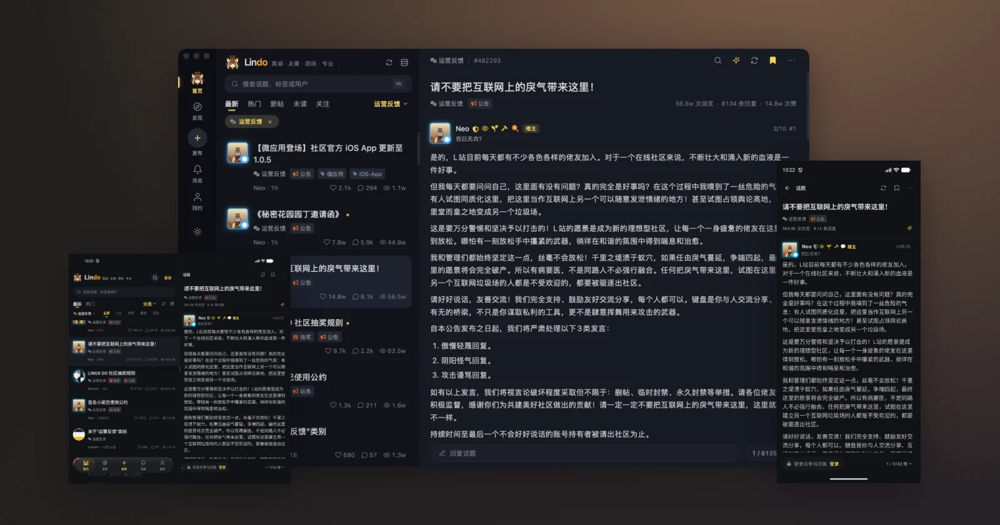

<p align="center">
  
</p>
<h1 align="center">LinDo</h1>
<p align="center">LINUX DO 第三方客户端，支持 Android、macOS、Windows 和 Linux。</p>
<p align="center">
  <a href="https://lindo.app/">官网</a> ·
  <a href="#下载安装">下载安装</a> ·
  <a href="https://lindo.app/docs">使用文档</a> ·
  <a href="https://github.com/lucaslus/LinDo/releases">版本记录</a>
</p>
<p align="center">
  <a href="https://lindo.app/#screens"></a>
</p>

## 下载安装

<!-- LINDO_DOWNLOAD_MATRIX_START -->
当前正式版 **[v1.1.5](https://github.com/lucaslus/LinDo/releases/tag/v1.1.5)**。校验清单 `SHA256SUMS.txt` 随版本发布。

| 平台 | 安装包 |
| :--- | :--- |
| **Android** | [APK · arm64](https://github.com/lucaslus/LinDo/releases/download/v1.1.5/lindo-1.1.5-build105.apk) |
| **Windows** | [安装程序 · x64](https://github.com/lucaslus/LinDo/releases/download/v1.1.5/Lindo-1.1.5-windows-x64-setup.exe)　·　[MSI · x64](https://github.com/lucaslus/LinDo/releases/download/v1.1.5/Lindo-1.1.5-windows-x64.msi) |
| **macOS** | [Apple Silicon DMG](https://github.com/lucaslus/LinDo/releases/download/v1.1.5/Lindo-1.1.5-macos-arm64.dmg)　·　[Intel DMG](https://github.com/lucaslus/LinDo/releases/download/v1.1.5/Lindo-1.1.5-macos-x64.dmg) |
| **Linux** | [AppImage · x86_64](https://github.com/lucaslus/LinDo/releases/download/v1.1.5/Lindo-1.1.5-linux-x86_64.AppImage)　·　[DEB · x86_64](https://github.com/lucaslus/LinDo/releases/download/v1.1.5/Lindo-1.1.5-linux-amd64.deb)　·　[RPM · x86_64](https://github.com/lucaslus/LinDo/releases/download/v1.1.5/Lindo-1.1.5-linux-x86_64.rpm) |
<!-- LINDO_DOWNLOAD_MATRIX_END -->

Arch Linux / Omarchy 可用仓库内的 [`PKGBUILD`](packaging/arch/PKGBUILD) 本地构建。[分平台安装说明](https://lindo.app/docs/install)

## 功能

- Android 界面使用 Kotlin 与 Compose。v1.1.5 的 arm64 APK 为 **17.2 MiB**，Apple Silicon 的 DMG 为 **11.6 MiB**，桌面端使用 Tauri 2、Rust 和 React。[发布资产](https://github.com/lucaslus/LinDo/releases/tag/v1.1.5)
- 折叠屏外屏用单栏。展开后列表和正文默认各占一半，可以拖动分隔线，也可以切回单栏。
- 切网后尝试恢复加载，站点验证可在应用内完成。v1.1.5 修复了 Linux 在代理或 TUN 模式下的验证循环。[版本说明](https://github.com/lucaslus/LinDo/releases/tag/v1.1.5)
- 已登录的设备可以生成登录二维码或口令。Android 支持扫码，桌面端可以识别二维码截图。
- Android 可更换启动图标。零度娘有多种表情，也可选 LINUX DO 标志，背景支持跟随系统深浅色。
- 阅读进度和草稿保存在本机。回复可跳到引用楼层，编辑器支持 Markdown 预览。
- Connect 显示官方周期指标。周期数据缺失时会标注当前显示的是账户累计数据。

<p align="center">
  <a href="website/public/shots/pixel9-fold-cover-v115.webp"></a>
  <a href="website/public/shots/pixel9-fold-open-v115.webp"></a>
</p>

## 安全与构建

LinDo 没有自建中转后端或遥测 SDK。社区请求与 LINUX DO 服务通信，登录凭证、草稿、阅读进度和诊断日志保存在设备上。安装包由公开的 GitHub Actions 流水线构建，每个正式发布附带 `SHA256SUMS.txt`。[网络与隐私说明](https://lindo.app/docs/security) · [发布工作流](.github/workflows/release.yml)

## 参与开发

欢迎提交复现步骤、体验建议和 Pull Request。[GitHub Issues](https://github.com/lucaslus/LinDo/issues)

| 目录 | 职责 |
| --- | --- |
| [`composeApp/`](composeApp) | Android 客户端、共享业务代码与测试 |
| [`desktop-tauri/`](desktop-tauri) | macOS、Windows、Linux 桌面客户端 |
| [`website/`](website) | 官网和文档 |

<details>
<summary>展开本地构建与调试说明</summary>

### 桌面端（Tauri 2：macOS / Windows / Linux）

需要 Node.js 22+、pnpm 10+ 与 Rust stable 工具链：

```sh
cd desktop-tauri
pnpm install
pnpm tauri dev      # 启动本地开发窗口
pnpm tauri build    # 构建对应平台的生产安装包
```

### Android 本地构建

需要 JDK 21、Android SDK 和已启动的 Android 模拟器或真机。Gradle daemon 固定使用 JDK 21；下例使用 Android Studio 自带的 JDK 21。也可将 `JAVA_HOME` 指向已安装的 JDK 21。

```sh
export JAVA_HOME="/Applications/Android Studio.app/Contents/jbr/Contents/Home"
export ANDROID_HOME="$HOME/Library/Android/sdk"
export PATH="$ANDROID_HOME/platform-tools:$PATH"
./gradlew :composeApp:assembleDebug
./gradlew :composeApp:testDebugUnitTest :composeApp:desktopTest
```

Debug APK：`composeApp/build/outputs/apk/debug/composeApp-debug.apk`。历史审查记录见 [`docs/review-2026-11-06.md`](docs/review-2026-11-06.md)。

### Android 自动预览

```sh
python3 scripts/android-dev.py --device emulator-5554
```

脚本监听共享代码、Android 代码、资源与 Gradle 配置，自动增量构建、`adb install -r` 覆盖安装并重启。保留登录数据，内存中的页面状态会重置。编译失败时保留已安装版本。`--once` 仅部署一次，`--skip-initial` 从监听开始；同一工作区只允许一个实例。macOS 优先使用 Android Studio JBR，其他环境使用 `JAVA_HOME`。

这是自动重新部署。Android Studio 的 [Live Edit](https://developer.android.com/develop/ui/compose/tooling/iterative-development) 可用于支持范围内的 Compose 函数体即时预览；[Compose Hot Reload](https://kotlinlang.org/docs/multiplatform/compose-hot-reload.html) 面向桌面 JVM。

### 零度娘品牌与通用状态

最终资产与来源见 [`design/brand-v3`](design/brand-v3/README.md)。App 使用真实 SVG 路径导出的 VectorDrawable，透明底人物；加载与刷新使用 Compose 图层轻摇摆，无 Lottie 依赖。网络异常、空内容、完成、分页结束、发送与上传等状态共用品牌组件。

```sh
python3 scripts/generate-brand-vectors.py
```

WebView 使用全屏网页与系统返回键，网站自身的登录、验证及加载页面由网站呈现。

### 自动化 UI 回归

已安装 Debug APK 后运行，无额外 Python 依赖：

```sh
python3 scripts/android-ui-smoke.py --device emulator-5554
```

覆盖欢迎页明暗主题、1.3/1.6 大字体、六种状态、关闭动效、全屏 WebView 与返回、重复释放、断网恢复、列表滚动、网页渲染进程恢复、系统图标加载、富文本结构/链接及 8 个入口的网络失败展示，共 22 项。测试会短暂调整系统字体和网络并在结束时恢复，不清除登录数据，不发送帖子、点赞或私信。结果在 `build/ui-smoke/results.json`，同目录保存截图。

Debug 专属预览（不退出当前账号）：

```sh
adb shell am start -n do_.linux.lindo/.MainActivity --es lindo.preview welcome
adb shell am start -n do_.linux.lindo/.MainActivity --ez lindo.brand_preview true
```

返回正常 App：`adb shell am start -S -n do_.linux.lindo/.MainActivity`。预览 Intent 仅在 debuggable 应用生效。

</details>

截图中的帖子是[《请不要把互联网上的戾气带来这里！》](https://linux.do/t/topic/482293)。徽章内置矢量由 LINUX DO 提供的 Font Awesome Free SVG 转换而来。图标 © Fonticons, Inc.，采用 [CC BY 4.0](https://creativecommons.org/licenses/by/4.0/) 许可。[Font Awesome Free 许可](https://fontawesome.com/license/free)
