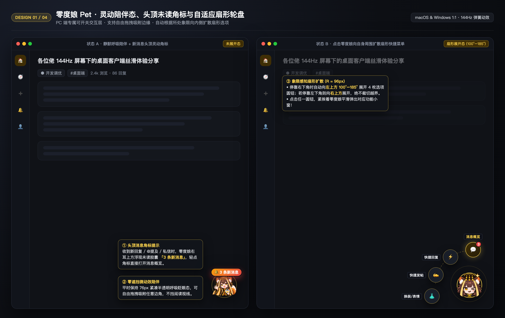
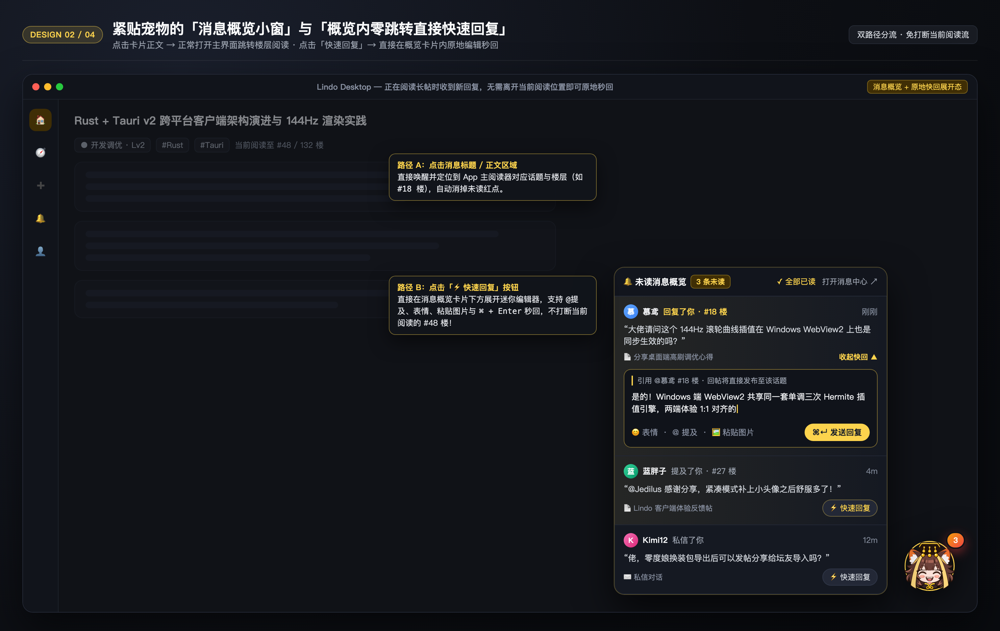
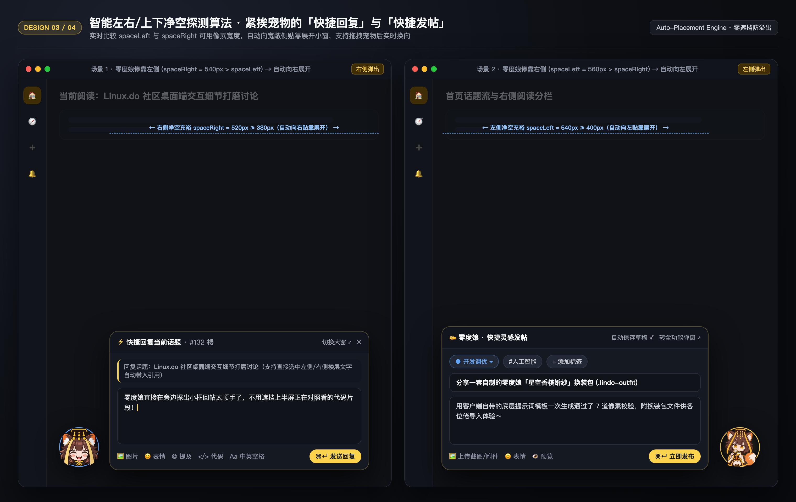
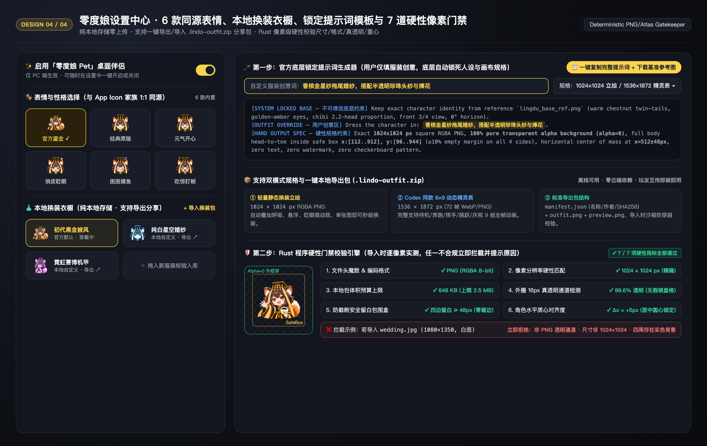
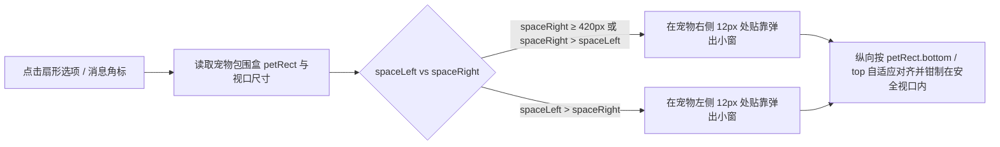

# 零度娘 Pet · PC 端专属桌面伴侣与本地换装工坊设计方案

> [!IMPORTANT]
> 本方案为 **PC 端（macOS & Windows）独有特色交互**，可在「设置 → 零度娘伴侣」中随时一键开启或关闭；所有自定义服装与动作资源 **100% 纯本地存储**，支持一键导出/导入 `.lindo-outfit.zip` 分享包，并通过 **Rust 后端 7 道像素级硬性门禁校验** 确保任何婚纱、机甲或奇装异服都严格符合尺寸、透明通道与重心规范。

---

## 一、四张核心交互与界面设计图（高清预览）

````carousel

<!-- slide -->

<!-- slide -->

<!-- slide -->

````

---

## 二、核心交互状态机与空间探测设计

### 1. 平时陪伴态 & 头顶新消息角标
- **自由拖拽与边缘磁吸**：支持在主窗口内按住拖拽至任意角落，松手后按归一化比例坐标 `(anchorX, anchorY)` 记忆位置，窗口缩放自动贴合不丢失。
- **头顶消息角标**：当轮询或实时状态存在未读通知/私信（`unreadCount > 0`）时，零度娘右耳上方浮现鎏金红渐变胶囊（如 `🔔 3 条新消息` 或数字角标 `3`），角色切换为竖耳提醒微动效。
- **零遮挡高刷保障**：全程仅使用合成器 `transform` 与 `opacity` 属性驱动呼吸/悬浮微动效，主窗口 144Hz/240Hz 滚轮阅读不受任何重排影响。

### 2. 点击扩散扇形轮盘（象限自适应防越界）
点击零度娘自身时，根据宠物当前圆心 `(cx, cy)` 到窗口四边的距离，自动计算扇形张开角度区间 `[\theta_{start}, \theta_{end}]`（半径 $R = 116\text{px}$）：
- **右下角停靠** → 向**左上方** `100°–185°` 展开；
- **左下角停靠** → 向**右上方** `-5°–80°` 展开；
- **上方区域停靠** → 向**下方内侧**展开。
- **4 个核心扇叶**：
  1. `💬 消息概览`（带实时未读角标）
  2. `⚡️ 快捷回复`（针对当前阅读话题或选中引用文字）
  3. `✍️ 快捷发帖`（轻量灵感速记发帖）
  4. `👗 换装 / 表情`（秒切 6 款表情或本地换装）

### 3. 智能左右/上下空间探测贴靠小窗 (`Smart Popover Placement`)



- **消息概览双路径分流**：
  - **点击消息标题/摘要区域** → 正常联动打开 App 主阅读区并精准滚动定位到对应话题楼层（同时消除未读）；
  - **点击卡片右下角「⚡️ 快速回复」** → 在该条消息卡片内直接展开迷你编辑器（自动带入 `@对方` 与对应 `reply_to_post_number`），支持表情、`@提及`、粘贴截图上传与 `⌘/Ctrl + Enter` 一键发送，**完全不打断当前正在阅读的长帖位置**。

---

## 三、6 款同源表情 + 本地换装系统 + 底层锁定提示词与硬性程序门禁

### 1. 与 App Icon 家族 1:1 对齐的多形态表情
直接复用并扩展客户端图标同源矢量/高清分层体系，支持一键切换（或随状态自动联动）：
- `官方鎏金 (Official)` · `经典原版 (Classic)` · `元气开心 (Happy)` · `俏皮眨眼 (Wink)` · `困困摸鱼 (Sleepy)` · `吃惊盯帧 (Surprised)`（后续新增 App Icon 时自动同步扩充选项）。

### 2. 双轨本地换装格式与 `.lindo-outfit.zip` 导入导出
支持两种标准化本地换装资源规格（存储于本地应用数据目录 `outfits/<outfit-id>/`，零云端上传）：

| 换装规格档位 | 精确像素尺寸 | 适用场景 | 动画表现 |
| :--- | :--- | :--- | :--- |
| **标准立绘换装单图** | `1024 × 1024 px` | 婚纱、汉服、机甲、奇装异服快速制作（1 张图即可用） | 客户端自动赋予呼吸缩放、悬浮摆动、眨眼贴图与粒子光效 |
| **Codex 级 8×9 动态精灵表** | `1536 × 1872 px`（单格 `192 × 208 px`） | 进阶全动作定制（与 Codex Custom Pet 网格 100% 兼容） | 完整 9 组状态帧序列（待机 / 拖拽左右跑 / 挥手 / 跳跃 / 提醒 / 庆祝） |

- **一键导出与导入分享**：点击任意自定义服装上的「导出」，生成标准 `.lindo-outfit.zip`（内含 `manifest.json` + `outfit.png` + 自动生成的缩略图 `thumb.png` 与 `SHA-256` 签名），可备份或发帖分享给其他用户本地导入。

### 3. 官方底层锁定提示词生成器（防崩脸、锁比例、锁透明边界）
用户在换装工坊中**只需输入衣服描述**（例如：`纯白拖尾星空婚纱与珍珠头纱` 或 `赛博朋克荧光机甲风衣`），程序自动锁死不可篡改的底层系统约束并支持一键复制 + 导出官方基准参考图 `lingdu_base_ref.png`：

```text
[LOCKED CHARACTER IDENTITY]
Use the attached `lingdu_base_ref.png` as the strict character identity reference: keep the exact warm chestnut twin-tails, golden-amber eyes, facial features, and 2.2-head chibi proportion, front-facing view, 0-degree level horizon.

[USER OUTFIT CUSTOMIZATION]
Replace ONLY her outfit and matching hair accessories with: {{用户输入的服装描述，例如：香槟金拖尾星空婚纱与薄纱头纱}}.

[HARD TECHNICAL CONSTRAINTS]
1. Exact 1024x1024 px square RGBA PNG with 100% pure transparent alpha background (alpha = 0).
2. Full character head-to-toe including dress hem/props MUST stay strictly inside safe box x:[96..928], y:[80..952] (leave >= 8% empty transparent margin on all four borders, zero cropping).
3. Horizontal visual center of mass aligned at x = 512 (+/- 48px).
4. Clean crisp cel-shaded anime game illustration, zero text, zero watermark, zero fake gray-white checkerboard background.
```

### 4. Rust 后端 7 道程序硬性校验门禁（100% 确定性像素实测拦截）

> [!TIP]
> **能否通过程序硬性检查尺寸、衣服大小与格式？完全可以做到！** 在 Rust 端直接解析原始字节流与 RGBA 像素矩阵，耗时 `< 15ms`，不符合任一条立即拒绝入库并给出具体原因提示：

1. **文件头魔数硬检 (`Magic Header Check`)**：校验前 8 字节必须为真实 PNG (`89 50 4E 47 0D 0A 1A 0A`) 或 WebP (`RIFF....WEBP`)，直接拦截改后缀名的 `.jpg`、`.bmp` 或非法文件。
2. **精确分辨率硬检 (`Exact Dimension Gate`)**：解码后 `(width, height)` 必须严格等于 `(1024, 1024)`（立绘模式）或 `(1536, 1872)`（8×9 精灵表模式），差 1px 即拦截（或提供一键居中缩放补透明边工具）。
3. **文件体积预算硬检 (`File Size Cap`)**：立绘单图 `<= 2.5 MB`、精灵表 `<= 6.0 MB`，确保内存与 144Hz 纹理渲染零负担。
4. **色彩模型与外框真透明检测 (`True Alpha Border Audit`)**：必须包含 Alpha 通道；扫描画布四边外圈 `16px` 边框带全部像素，要求 `alpha <= 8` 的透明像素占比 **`>= 96%`**，并检测高频双色交替网格特征以精准拦截 AI 假棋盘格背景。
5. **服装包围盒占比与防截断留白检测 (`Bounding-Box & Safe Margin Gate`)**：扫描所有 `alpha > 24` 像素得出包围盒 `[minX, minY, maxX, maxY]`：
   - 有效像素面积占比须在 **`14% – 68%`** 之间（拦截人物过小如蚂蚁，或巨大大头贴）；
   - `minX >= 32, maxX <= 992, minY >= 32, maxY <= 992`（确保婚纱大裙摆、翅膀、头饰未在画布边缘被硬生生切平截断）。
6. **水平视觉质心居中校验 (`Center-of-Mass Alignment`)**：计算非透明像素加权质心 $\bar{x}$，要求 $|\bar{x} - 512| \le 64\text{px}$，保证点击零度娘展开扇形菜单时圆心始终精准对准角色身体正中。
7. **`.lindo-outfit.zip` 压缩包安全沙箱校验**：严格校验条目数量（`<= 6` 个文件）、总解压字节数（`< 10 MB` 防 Zip Bomb）、禁止 `..` 或绝对路径（防 Zip Slip），并核对 `manifest.json` 内记录的 `SHA-256`。

---

## 四、待确认细节（确认后即可直接进入开发落地）

1. **停靠范围偏好**：默认做成**主窗口内灵动悬浮层**（跟随 Lindo 窗口、零系统权限弹窗、弹出消息概览和快回小窗最丝滑无割裂），是否需要同时在设置里提供一个可选的「独立桌面置顶小窗模式（最小化主窗口后仍留在桌面上提示新消息）」？
2. **扇形菜单默认四项**：当前设计为 **`💬 消息概览`、`⚡️ 快捷回复`、`✍️ 快捷发帖`、`👗 换装/表情`** 四个高频动作，您看是否需要增减（例如加入「一键刷新/回到顶部」或保持这 4 项最清爽）？
